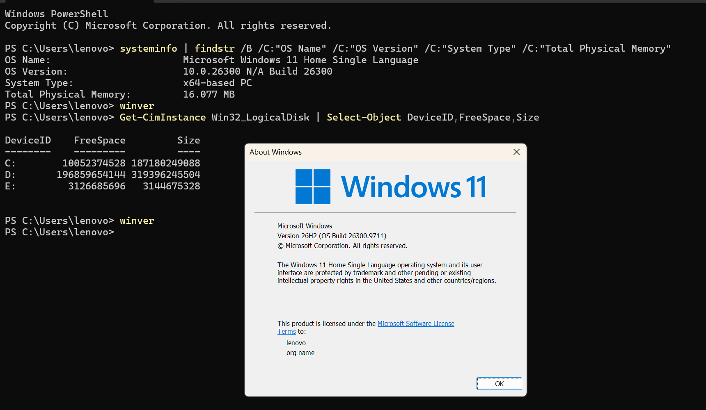
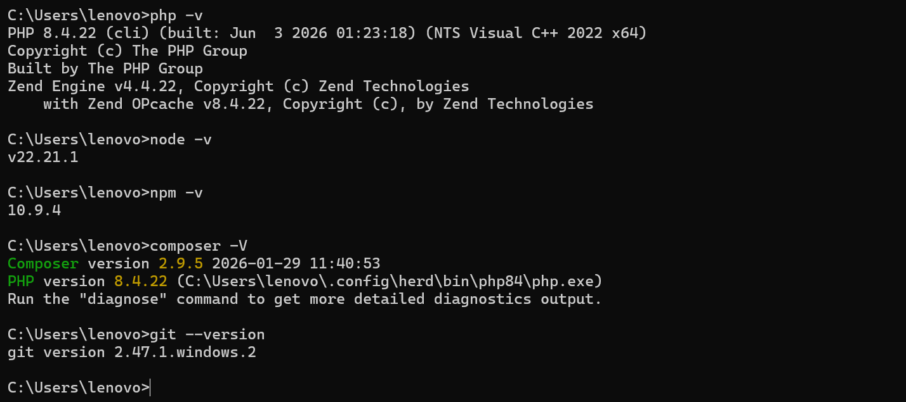
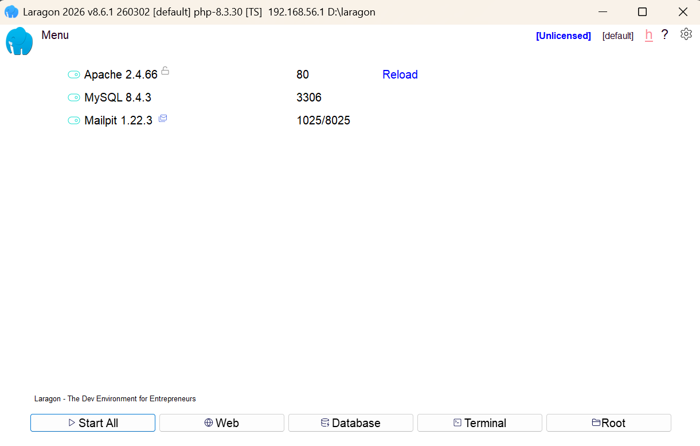

# Laporan Lingkungan Pengembangan

## 1. Spesifikasi Platform (KUK 1.1)
Berikut adalah spesifikasi perangkat keras dan sistem operasi yang digunakan:

| Item | Nilai |
|---|---|
| **Sistem operasi dan versi** | Microsoft Windows 11 Home Single Language (10.0.26300 N/A Build 26300) |
| **Arsitektur** | 64-bit |
| **RAM total** | 16.077 MB |
| **Ruang disk kosong** | C: 8.88 GB, D: 181.91 GB, E: 2.91 GB |
| **Hak akses** | Administrator |

*( Screenshot hasil perintah KUK 1.1)*

## 2. Kebutuhan Proyek dan Matriks Pemilihan Tools (KUK 1.2)
**Kebutuhan Proyek:**
* Menjalankan PHP.
* Menyimpan data di database.
* Menjalankan JavaScript di luar browser.
* Mengelola versi kode.
* Mengelola library PHP.

**Matriks Pemilihan Tools (Server Lokal):**
| Kriteria | XAMPP | Laragon |
|---|---|---|
| Kesesuaian OS peserta | 5 | 5 |
| Kemudahan instalasi dan pemakaian | 4 | 5 |
| Kebutuhan sumber daya | 3 | 5 |
| Dukungan dokumentasi/komunitas | 5 | 5 |
| Lisensi dan sumber unduhan resmi | 5 | 5 |
| **Total** | **22** | **25** |

**Alasan Pemilihan:** Laragon dipilih karena memiliki skor total lebih tinggi (25 berbanding 22). Laragon lebih ringan, cepat di Windows, dan mendukung pembuatan virtual host secara otomatis. Untuk Editor, VS Code dipilih karena memiliki ekstensi lengkap, terminal terpadu, dan gratis.

## 3. Langkah Instalasi Tools dan Kendala (KUK 2.1)
* **VS Code:** Diunduh dari situs resmi, dipasang dengan opsi "Add to PATH" dan "Open with Code".
* **Laragon:** Mengunduh edisi Full, dipasang ke `C:\laragon`.
* **Node.js:** Menggunakan versi LTS dan opsi "Add to PATH".
* **Composer:** Diarahkan ke `php.exe` bawaan Laragon.
* **Git:** Dipasang dengan pengaturan default.

**Kendala & Solusi:** 
* *Kendala:* Port 80 berkonflik dengan aplikasi lain  sehingga Apache langsung berhenti.
* *Solusi:* Mengecek proses dengan `netstat -ano | findstr :80`, lalu menghentikan proses tersebut atau mengubah port Apache ke 8080 di `httpd.conf`.

## 4. Tabel Verifikasi Versi (KUK 2.2)
| Tools | Perintah | Versi yang Terpasang |
|---|---|---|
| PHP | `php -v` | 8.4.22 |
| Node.js | `node -v` | v22.21.1 |
| npm | `npm -v` | 10.9.4 |
| Composer | `composer -V` | 2.9.5 |
| Git | `git --version` | 2.47.1.windows.2 |

*(Screenshot dari terminal yang menunjukkan hasil perintah di atas dan screenshot layanan web server/database berjalan di panel kontrol)*

## 5. Script Uji dan Keluaran (KUK 3.1, 3.2)
Tiga berkas skrip telah dibuat dan ditempatkan di folder document root (misal `www` untuk Laragon) pada direktori `hari-01`:
1. **`index.html`**: Skrip HTML statis yang berhasil dirender browser dengan info *user agent* JavaScript.
2. **`tes.js`**: Dieksekusi melalui terminal dengan `node tes.js` dan berhasil mencetak "Instalasi Node.js berhasil!" beserta versi OS.
3. **`tes.php`**: Diakses via `http://localhost/hari-01/tes.php` dan menampilkan teks "Instalasi Berhasil!", menampilkan PHP_VERSION, SERVER_SOFTWARE (Apache), dan Waktu Server.