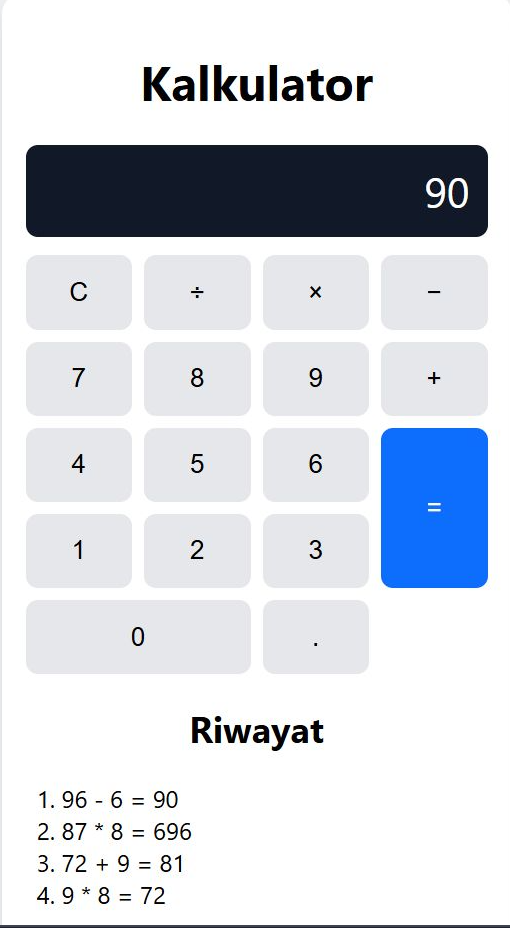
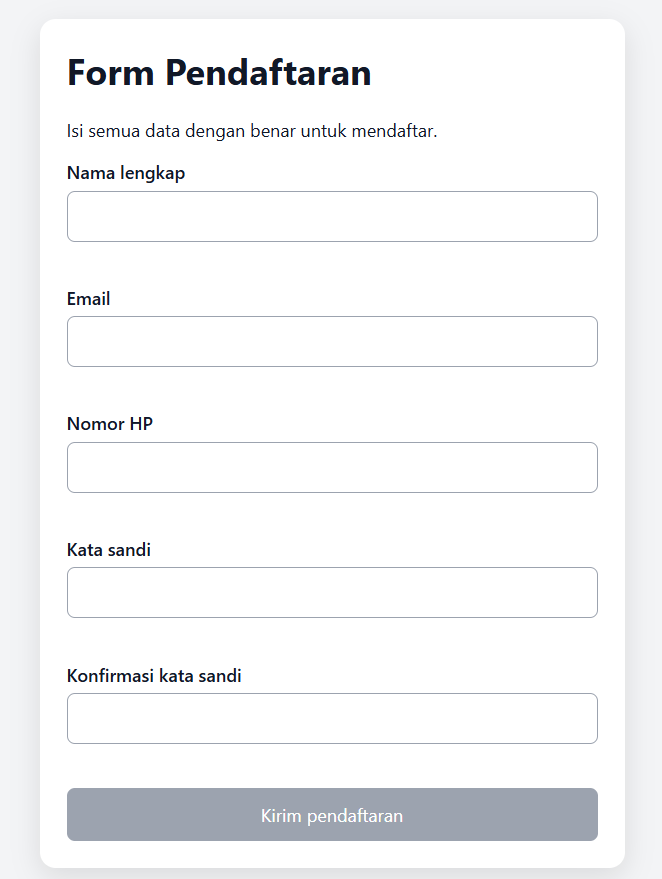

# Proyek 2 - Kalkulator dan Form Validator

Proyek latihan JavaScript Hari 5, berisi dua aplikasi yang menggunakan ES Modules.

## Struktur
- `kalkulator/`: kalkulator interaktif dengan operasi matematika, validasi pembagian nol, dukungan keyboard, dan riwayat 5 perhitungan terakhir.
- `validator/`: form pendaftaran dengan validasi nama, email, nomor HP, kata sandi, dan konfirmasi kata sandi.

## Cara menjalankan
1. Buka folder `proyek-2-kalkulator` di Visual Studio Code.
2. Pasang ekstensi **Live Server** jika belum tersedia.
3. Klik kanan `kalkulator/index.html`, lalu pilih **Open with Live Server**.
4. Untuk aplikasi kedua, buka `validator/index.html` dengan Live Server.
5. Jangan membuka file secara langsung dengan `file://`, karena browser dapat memblokir ES Modules.

## Aturan validasi
- Nama: minimal 3 karakter.
- Email: format email sederhana.
- Nomor HP: diawali `08` dan berjumlah 10 sampai 13 digit.
- Kata sandi: minimal 8 karakter, mengandung huruf dan angka.
- Konfirmasi kata sandi: harus sama dengan kata sandi.
- Ringkasan pendaftaran tidak menampilkan kata sandi.

## Kasus yang diuji
### Kalkulator

- Penjumlahan, pengurangan, perkalian, dan pembagian.
- `0.1 + 0.2` ditampilkan sebagai `0.3`.
- Pembagian dengan nol menampilkan pesan error.
- Tombol `C` memulihkan layar.
- Input desimal, operator berulang, dan keyboard.

### Form Validator

- Field kosong dan nama terlalu pendek.
- Format email tidak valid.
- Nomor HP tidak diawali `08` atau panjangnya tidak sesuai.
- Kata sandi terlalu pendek atau tidak mengandung huruf/angka.
- Konfirmasi kata sandi tidak cocok.
- Tombol kirim nonaktif sampai seluruh field valid.
- Ringkasan hanya berisi nama, email, dan nomor HP.
