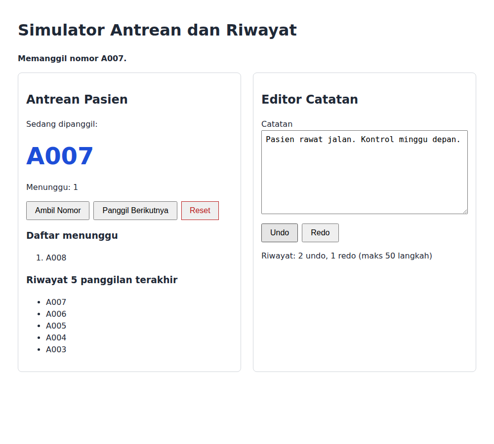
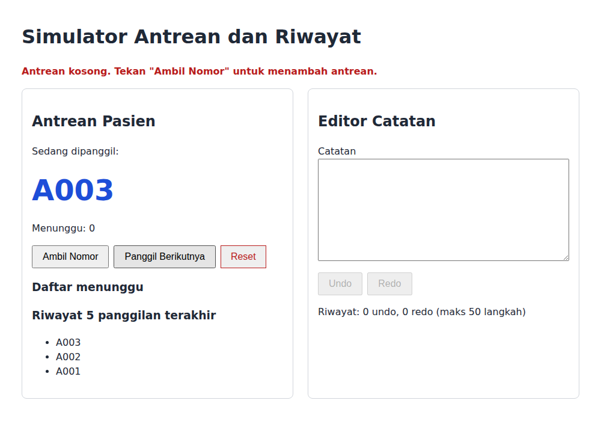
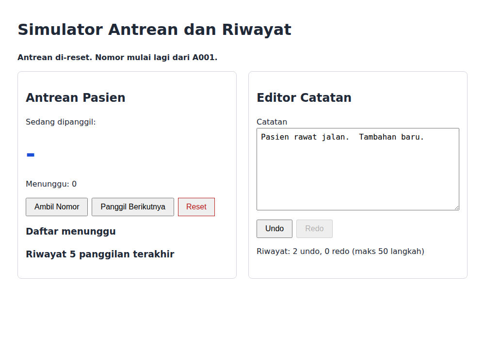
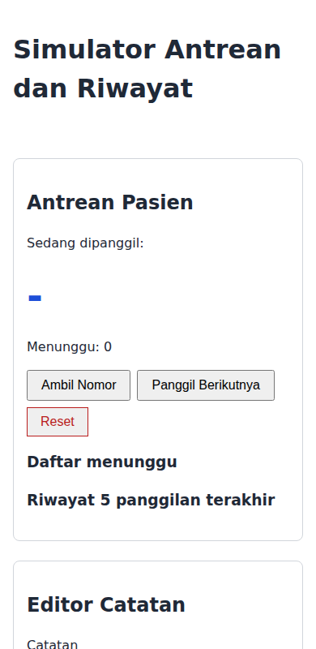

# Proyek 3 - Simulator Antrean dan Riwayat

Simulator untuk sebuah klinik kecil: layar antrean pasien (Fitur A) dan editor catatan dengan undo/redo (Fitur B). Proyek ini menerapkan struktur data Hari 6-7 dan guideline kode bersih.

## Cara menjalankan

Halaman memakai ES Module sehingga harus dibuka lewat server lokal (bukan `file://`):

```bash
npm run serve
```

Lalu buka <http://localhost:8080/index.html>.

Untuk memeriksa kualitas kode (butuh `npm install` sekali):

```bash
npm run lint      # ESLint
npm run format    # Prettier
```

## Struktur proyek

```
proyek-3-antrian/
  index.html
  css/style.css
  js/
    structures.js   # Stack, LinkedList, LinkedQueue (tanpa UI)
    antrian.js      # logika antrean (memakai structures.js)
    riwayat.js      # logika undo/redo (memakai structures.js)
    app.js          # penghubung DOM
  screenshots/
  README.md
```

## Fitur

- **Antrean:** Ambil Nomor (A001, A002, ...), Panggil Berikutnya (FIFO, tampil besar), jumlah dan daftar menunggu, riwayat 5 panggilan terakhir, Reset dengan konfirmasi, pesan jelas bila antrean kosong.
- **Editor:** dua Stack (undo dan redo), tombol Undo/Redo nonaktif bila kosong, riwayat maksimal 50 langkah dengan penghitung, snapshot disimpan setelah jeda mengetik 600 ms, catatan terakhir disimpan di `localStorage`.

## Tangkapan layar



Antrean kosong saat Panggil ditekan lagi:



Setelah Reset:



Tampilan ponsel:



## Alasan pemilihan struktur data

| Kebutuhan                    | Struktur dipilih            | Alasan                                                             | Alternatif dan mengapa tidak dipilih                              |
| ---------------------------- | --------------------------- | ------------------------------------------------------------------ | ----------------------------------------------------------------- |
| Antrean pasien               | `LinkedQueue`               | `enqueue` dan `dequeue` O(1); detail node tersembunyi              | Array + `shift` (O(n) per pengambilan, lambat pada antrean besar) |
| Riwayat undo/redo            | `Stack` (dua buah, maks 50) | Perubahan terakhir dibatalkan lebih dulu (LIFO); `push`/`pop` O(1) | Queue (urutan salah: yang tertua yang dibatalkan lebih dulu)      |
| Riwayat 5 panggilan terakhir | Array dibatasi panjang      | Ukuran kecil dan tampil berurutan dari yang terbaru                | Linked list (berlebihan untuk 5 elemen)                           |

## Penanganan error

- `panggilBerikutnya()` pada antrean kosong mengembalikan `null`; UI menampilkan pesan yang menjelaskan langkah berikutnya.
- `pop`/`dequeue`/`removeFirst` pada struktur kosong mengembalikan `undefined` tanpa melempar error.
- Input tidak valid (catatan bukan teks, batas stack kurang dari 1) melempar `ValidasiError` dengan pesan dan nama kolom.
- Kegagalan `localStorage` ditangkap dan dilaporkan ke pengguna, bukan ditelan.
