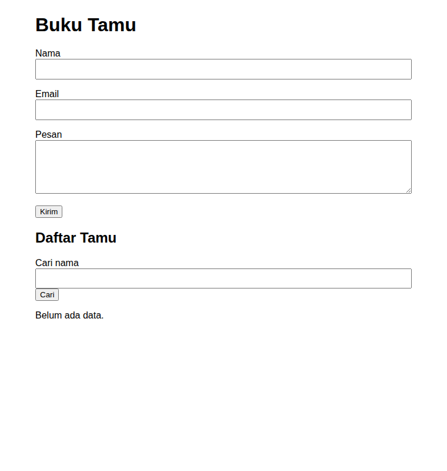
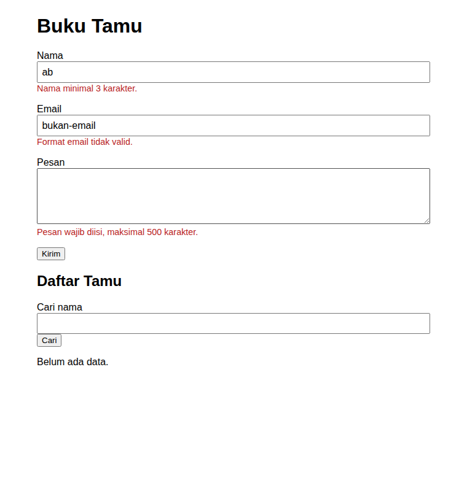
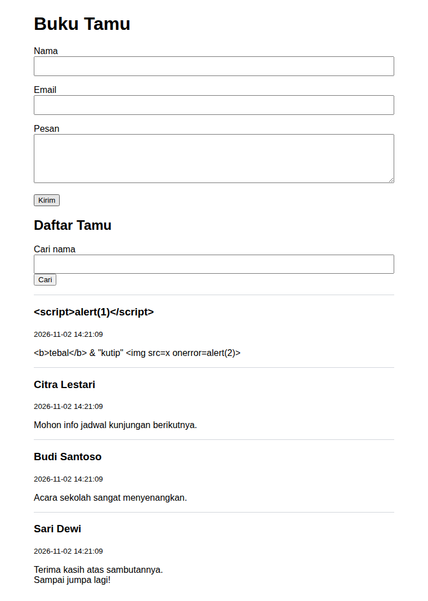
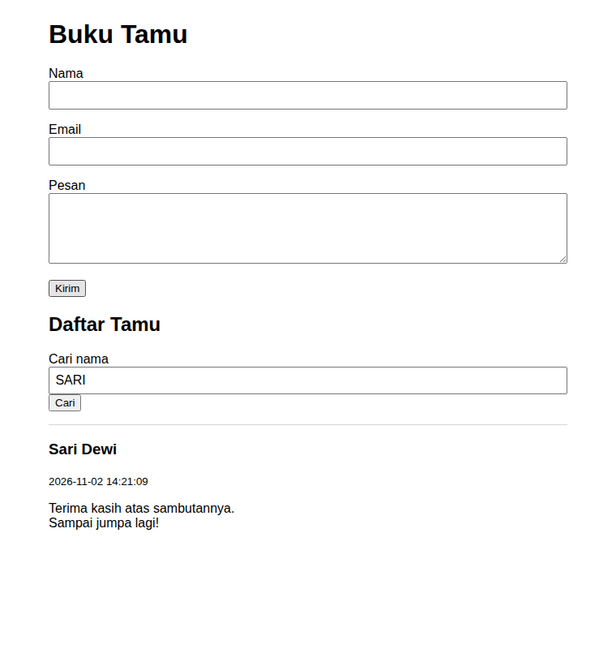
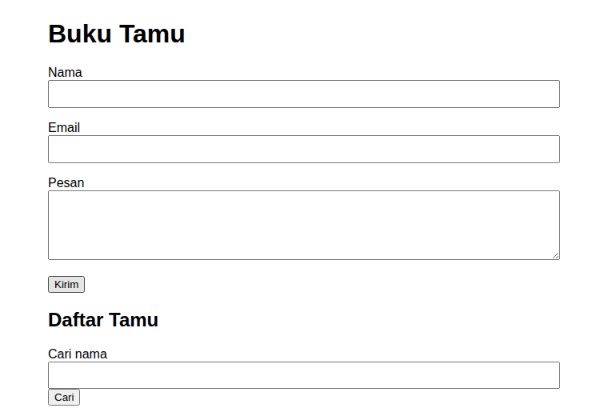

# Proyek 4 - Buku Tamu Berbasis File

Buku tamu daring sederhana tanpa basis data untuk sebuah sekolah. Pengunjung mengisi nama, email, dan pesan; pesan terbaru tampil di atas, dan daftar dapat dicari berdasarkan nama. Data disimpan di `data/tamu.json`.

## Cara menjalankan

Syarat: PHP 8.1 atau lebih baru dengan ekstensi `mbstring`.

```bash
php -S localhost:8000
```

Lalu buka <http://localhost:8000/index.php>. Dengan Apache, salin folder ini ke `htdocs/` dan buka `http://localhost/proyek-4-buku-tamu/index.php`.

## Struktur

```
proyek-4-buku-tamu/
  index.php        # tampilan dan alur request
  functions.php    # logika: validasi, simpan, baca, cari
  data/
    .htaccess      # Require all denied
    tamu.json      # dibuat otomatis saat pesan pertama tersimpan
  screenshots/
  README.md
```

## Fitur

- Validasi sisi server dengan pesan per kolom: nama minimal 3 karakter, email valid, pesan 1-500 karakter. Data yang sudah diisi tetap tampil di form saat validasi gagal.
- Pesan disimpan dengan `json_encode` dan dibaca dengan `json_decode`; folder `data/` dibuat otomatis bila belum ada; penulisan memakai `LOCK_EX`.
- Pesan terbaru tampil di atas; pencarian nama lewat `$_GET['q']` tanpa peka huruf besar-kecil.
- Semua output di-escape dengan `htmlspecialchars`; setelah berhasil menyimpan dipakai pola Post/Redirect/Get.
- Folder `data/` dilindungi `.htaccess` (`Require all denied`).
- Berkas data yang rusak tidak ditimpa dan ditampilkan sebagai pesan kesalahan yang jelas.

## Tangkapan layar

Form kosong dan daftar belum berisi data:



Galat validasi per kolom, data lama tetap tampil:



Daftar tamu (terbaru di atas):



Pencarian nama "SARI":



Uji XSS: masukan `<script>` tampil sebagai teks:


