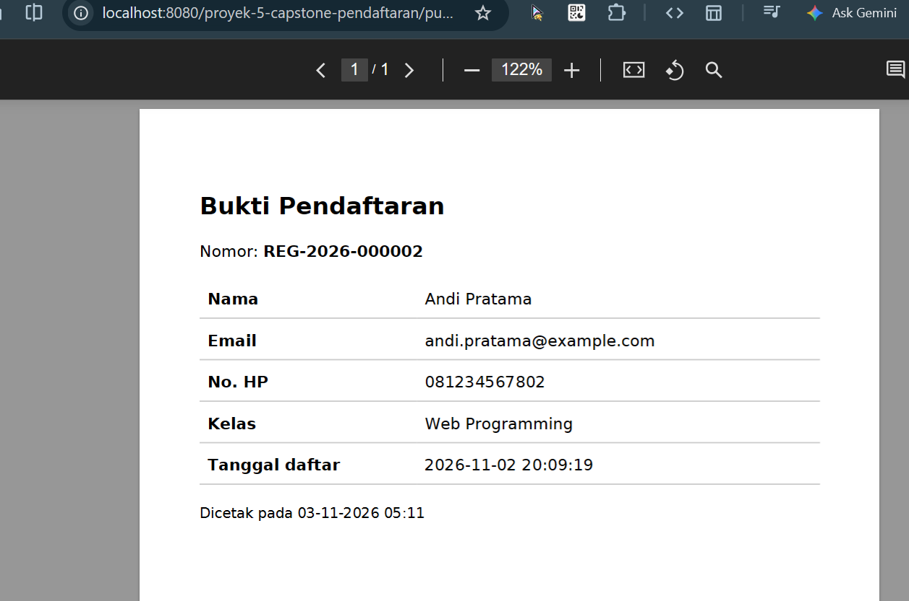

# Daftar Library - Capstone Pendaftaran Pelatihan

## 1. Tabel ringkas

| Library | Versi dipakai | Fungsi | Lisensi | Alternatif | Dependency | Rilis terakhir / status | Alasan dipilih |
|---|---|---|---|---|---|---|---|
| Bootstrap | 5.3.3 (CDN, dipin) | UI responsif | MIT | Tailwind CSS, Bulma | Popper (di dalam bundle) | npm terbaru 5.3.8 (diubah 8 Okt 2026), aktif. CDN masih 5.3.3, bisa dinaikkan ke 5.3.8 setelah diuji | Cepat, dokumentasi lengkap, komponen navbar/form siap pakai |
| jQuery | 3.7.1 (CDN, dipin) | DOM; syarat DataTables 1.x | MIT | JavaScript biasa | - | Aktif. Versi major lebih baru (4.x) ada, tidak dipakai karena DataTables 1.13.8 mengikuti jQuery 3 (sesuai modul) | Hanya dipakai untuk DataTables, bukan untuk logika lain |
| DataTables | 1.13.8 (CDN, dipin) | Cari, urut, paginasi di browser | MIT | Grid.js | jQuery | Aktif. Versi major lebih baru ada; migrasi dilakukan dengan rencana, bukan otomatis | Fitur lengkap tanpa kode manual |
| SweetAlert2 | 11.26.25 (CDN, dipin) | Dialog konfirmasi + toast | MIT | Toastify | - | npm terbaru 11.26.25 (diubah 23 Mei 2026), aktif | Pengganti `confirm()` / `alert()` |
| Dompdf | (v3.1.6) | PDF dari HTML/CSS | LGPL | FPDF, TCPDF | PHP 8.x, ext `mbstring`, `dom`, `gd` | `composer outdated`: Everything up to date (3 Nov 2026) | Tata letak cukup ditulis dengan HTML/CSS |
| FPDF (pembanding) | tidak dipasang | PDF dengan perintah posisi manual | Permisif | - | - | - | Dibandingkan, lihat bagian 4 |

## 2. Hasil perintah 

```
npm view bootstrap license version time.modified
license = 'MIT'
version = '5.3.8'
time.modified = '2026-10-08T16:48:03.014Z'

npm view sweetalert2 license version
license = 'MIT'
version = '11.26.25'

composer licenses
Name: peserta/pendaftaran-pelatihan
Version: dev-main 05fb288
Licenses: none
Dependencies:

Name                      Version Licenses          
dompdf/dompdf             v3.1.6  LGPL-2.1          
dompdf/php-font-lib       1.0.2   LGPL-2.1-or-later 
dompdf/php-svg-lib        1.0.2   LGPL-3.0-or-later 
masterminds/html5         2.12.0  MIT               
sabberworm/php-css-parser v9.5.0  MIT      

composer outdated
Direct dependencies required in composer.json:
Everything up to date

Transitive dependencies not required in composer.json:
Everything up to date

composer audit
No security vulnerability advisories found.

npm outdated   
Package    Current  Wanted  Latest  Location                Depended by
bootstrap  5.2.0    5.3.8   5.3.8   node_modules/bootstrap  hari-10-update

npm audit  
found 0 vulnerabilities
```

## 3. Estimasi efisiensi (T1)

Rumus: `penghematan = waktu buat sendiri - (belajar + integrasi + pemeliharaan)`

| Library | Buat sendiri | Belajar + integrasi + pemeliharaan | Hemat |
|---|---|---|---|
| Dompdf | 40 jam (contoh modul) | 2 + 3 + 1 = 6 jam | 34 jam (85%) |
| DataTables | 30 jam | 2 + 2 + 1 = 5 jam | 25 jam (83%) |
| SweetAlert2 | 16 jam | 1 + 1 + 0,5 = 2,5 jam | 13,5 jam (84%) |
| Bootstrap | 60 jam | 4 + 4 + 2 = 10 jam | 50 jam (83%) |

Dasar estimasi :
- **DataTables**: membuat pencarian, pengurutan multi-kolom, paginasi, dan terjemahan bahasa Indonesia sendiri dengan JavaScript.
- **SweetAlert2**: membuat dialog konfirmasi dan toast sendiri, lengkap dengan animasi, tombol, dan dukungan keyboard.
- **Bootstrap**: membuat CSS responsif sendiri (grid, navbar yang bisa dibuka di ponsel, gaya form dan tabel) serta JavaScript menu.
Angka selain Dompdf adalah estimasi pribadi.

## 4. Keputusan

**DataTables sisi klien vs server-side.** Halaman daftar memuat semua baris lewat `ambilSemuaPendaftar()` lalu DataTables mencari, mengurutkan, dan membagi halaman di browser. Cocok untuk ratusan sampai beberapa ribu baris. Bila data sangat besar, pindah ke paginasi sisi server (PHP, seperti Hari 9) atau mode `serverSide` DataTables.

**Dompdf vs FPDF.**

| Aspek | Dompdf | FPDF |
|---|---|---|
| Cara membuat tata letak | HTML + CSS (fleksibel) | Perintah posisi manual (`Cell`, `SetFont`) |
| Kesederhanaan | Lebih berat, banyak dependency | Ringan, tanpa dependency |
| Lisensi | LGPL | Permisif |
| Pilihan | **Dipakai**: bukti pendaftaran mudah diubah lewat template HTML | Alternatif bila ingin dokumen sangat sederhana |

## 5. Library usang (Lab 1 no. 4)

Contoh: fungsi `mysql_*` pada PHP (dihapus sejak PHP 7).
- Tanda usang: dihapus dari PHP, tutorial lama masih memakainya, tidak ada pembaruan keamanan.
- Pengganti yang dianjurkan: **PDO** (sudah dipakai di proyek ini) dengan prepared statement.

(Boleh diganti dengan contoh library usang lain yang Anda temukan sendiri.)

## 6. Kapan lisensi GPL bermasalah (Lab 1 no. 5)

GPL bermasalah untuk aplikasi komersial **tertutup** ketika aplikasi itu **didistribusikan** (dijual, diberikan ke klien, dipasang di perangkat) dan menggabungkan kode GPL ke dalamnya. Karya turunan wajib dirilis dengan lisensi GPL dan kode sumbernya dibuka, padahal aplikasi ingin dirahasiakan. Untuk AGPL, kewajiban yang sama berlaku juga bila aplikasi hanya dijalankan sebagai layanan jaringan. Library MIT/BSD/Apache tidak punya syarat ini; LGPL (Dompdf) boleh dipakai aplikasi tertutup selama perubahan pada library-nya sendiri dibuka. Ini ringkasan umum, bukan nasihat hukum; baca berkas `LICENSE` resmi.

## 7. Catatan pembaruan (Lab 6)

### 7.1 Tabel pembaruan

| Tanggal | Library | Dari | Ke | Hasil uji / catatan |
|---|---|---|---|---|
| 3 Nov 2026 | bootstrap (percobaan npm, folder `hari-10-update`) | 5.2.0 | 5.3.8 (Wanted; konfirmasi dengan `npm ls bootstrap`) | `npm audit`: 0 vulnerabilities. `npm update` tidak lompat ke major karena rentang `^5.2.0` hanya mengizinkan sampai sebelum 6.0.0 |
| 3 Nov 2026 | dompdf/dompdf (Capstone) | v3.1.6 | tidak berubah | `composer outdated`: Everything up to date. `composer update dompdf/dompdf --with-dependencies` tidak mengubah apa pun. Uji `cetak.php?id=1`:  |

### 7.2 Penjelasan kolom `npm outdated`

- **Current** 5.2.0: versi yang terpasang saat ini.
- **Wanted** 5.3.8: versi tertinggi yang masih diizinkan rentang di `package.json` (`^5.2.0`); inilah yang dipasang `npm update`.
- **Latest** 5.3.8: versi terbaru di registry. Kebetulan sama dengan Wanted karena belum ada Bootstrap 6. Bila suatu hari Latest berupa versi major baru, `npm update` tidak akan menyentuhnya; naik major harus manual setelah membaca changelog dan menguji menyeluruh (Semantic Versioning: perubahan MAJOR dapat merusak).

### 7.3 Catatan kendala

Percobaan pertama `composer update dompdf/dompdf --with-dependencies` menampilkan `curl error 6 ... Could not resolve host: repo.packagist.org` dan memakai data cache, sehingga hasilnya tidak dipakai sebagai bukti. Setelah koneksi pulih, `composer outdated` diulang dan hasilnya tercatat di bagian 2.

### 7.4 Skenario gagal (rollback)

Langkah: (1) commit kondisi awal, (2) `git switch -c uji-update`, (3) `composer update dompdf/dompdf --with-dependencies`, (4) `git restore composer.json composer.lock`, (5) `composer install`, (6) kembali ke cabang utama.

Hasil: composer.json dan composer.lock kembali ke versi commit; aplikasi tetap berjalan

### 7.5 Strategi pembaruan

Patch dan minor diperbarui berkala; major dengan rencana; pembaruan keamanan tidak ditunda. CDN dipin ke versi persis (tanpa `latest`), jadi kenaikan versi di `templates/header.php` dan `footer.php` dilakukan sengaja setelah diuji.