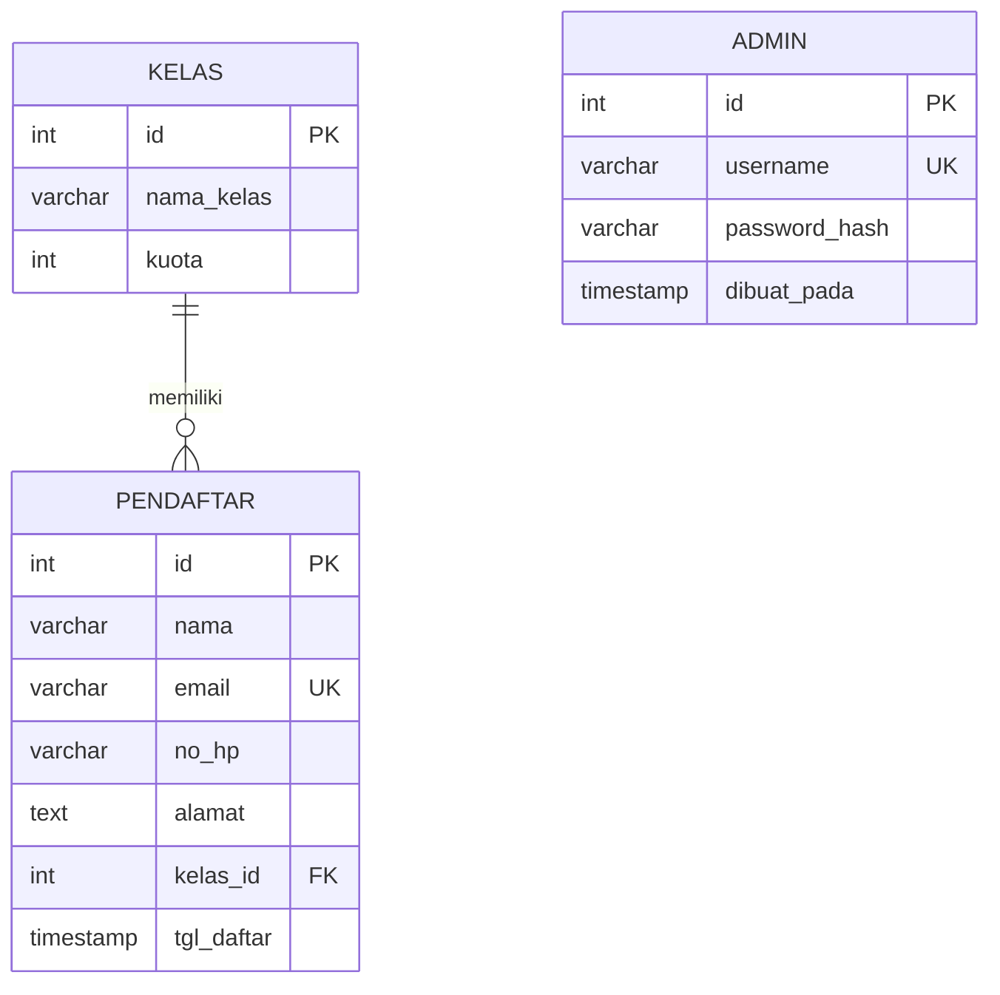

# Arsitektur

## 1. Struktur Folder

```
config/      koneksi database dan konfigurasi (config.php tidak di-commit)
src/         logika aplikasi (helpers, validasi, pendaftar, auth, bootstrap)
public/      halaman web (document root) dan assets/js
templates/   header, footer, dan templat PDF
database/    skema.sql, buat-admin.php, latihan.sql
docs/        dokumentasi (api, modul, arsitektur, kasus uji, laporan bug, panduan)
tests/       uji otomatis sederhana
vendor/      dependensi Composer (tidak di-commit)
```

## 2. Alur Request

1. Browser meminta halaman di `public/`.
2. Halaman memuat `src/bootstrap.php`: sesi, konfigurasi, modul, exception handler.
3. Halaman admin memanggil `wajibLogin()`; tanpa sesi login, dialihkan ke `login.php`.
4. Permintaan POST diperiksa `cekCsrf()`, lalu divalidasi (`validasiPendaftar()`).
5. Data dibaca/ditulis lewat PDO prepared statement (`src/pendaftar.php`).
6. Halaman memuat `templates/header.php`, merender isi, lalu `templates/footer.php`.

## 3. ERD



Tabel `admin` berdiri sendiri (tidak berelasi dengan data pendaftar). Relasi `pendaftar.kelas_id` memakai `ON DELETE RESTRICT`: kelas yang masih punya pendaftar tidak dapat dihapus.

## 4. Struktur Data yang Dipilih (SKKNI 004.02)

| Kebutuhan | Struktur dipilih | Alasan | Alternatif |
|---|---|---|---|
| Menampilkan peringkat kelas berdasarkan jumlah pendaftar | Array asosiatif per kelas (`nama_kelas`, `kuota`, `terisi`, `sisa`) diurutkan dengan `usort()` (`peringkatKelas()`) | Jumlah kelas kecil; array asosiatif langsung sesuai baris hasil query; pembanding dua tingkat (terisi menurun, nama A-Z) membuat hasil stabil dan mudah diuji | `ORDER BY` di SQL (kurang mudah diuji otomatis tanpa database); `SplPriorityQueue` (berlebihan untuk beberapa kelas) |
| Memetakan hasil query ke form/tabel | Array asosiatif | Kunci bernama membuat kode mudah dibaca dibanding indeks angka | Objek/DTO (lebih verbose untuk aplikasi sekecil ini) |
| Menyimpan galat validasi per kolom | Array asosiatif `kolom => pesan` | Form cukup `isset($galat['nama'])` untuk menandai kolom | Daftar pesan datar (tidak bisa ditempel ke kolom tertentu) |

## 5. Keputusan Keamanan Penting

- Semua query memakai prepared statement; output di-escape dengan `e()`.
- Formulir POST dilindungi token CSRF; logout hanya lewat POST.
- Sandi memakai `password_hash`/`password_verify`; sesi diregenerasi saat login.
- Kuota dijaga dengan transaksi dan `SELECT ... FOR UPDATE`.
- Pesan error teknis hanya ke log server; pengguna menerima pesan umum.
