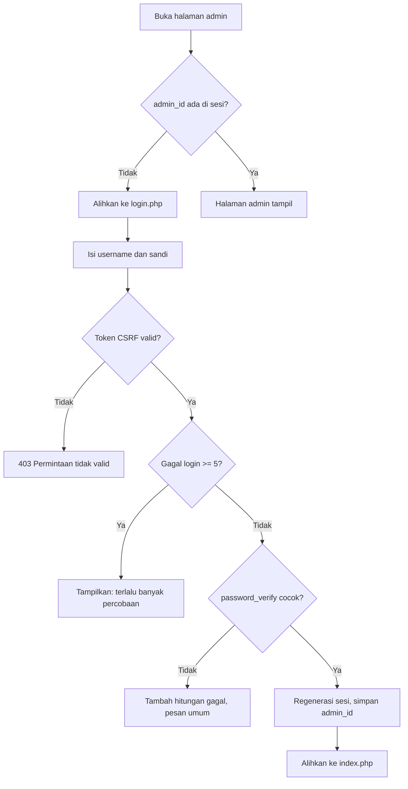
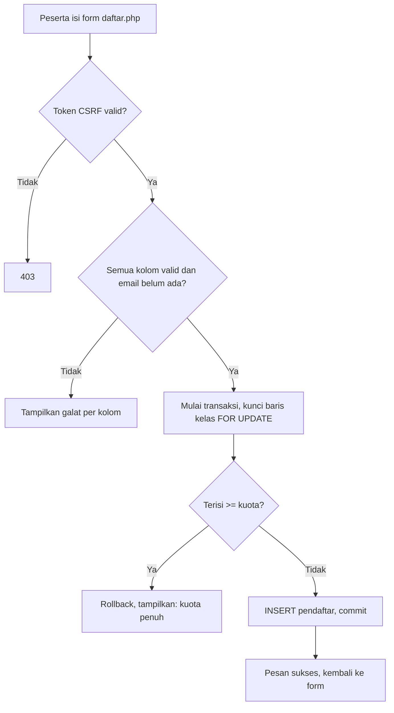

# Peta Modul - Sistem Pendaftaran Pelatihan

Dokumen ini memetakan berkas, tanggung jawab, dan fungsi publik di `config/`, `src/`, dan `public/`.

## 1. Peta Berkas

| Berkas | Tanggung jawab | Fungsi/kelas publik |
|---|---|---|
| `config/database.php` | Koneksi database (PDO) | `getConnection()` |
| `config/config.php` | Kredensial lokal (tidak di-commit) | - |
| `config/config.contoh.php` | Contoh konfigurasi untuk instalasi baru | - |
| `src/bootstrap.php` | Sesi, konfigurasi, muat modul, exception handler global | - |
| `src/helpers.php` | Utilitas umum dan keamanan | `e()`, `redirect()`, `tokenCsrf()`, `cekCsrf()`, `setFlash()`, `ambilFlash()` |
| `src/validasi.php` | Logika murni yang mudah diuji | `validNoHp()`, `hitungSisaKuota()`, `formatNomorBukti()`, `peringkatKelas()` |
| `src/pendaftar.php` | Akses data, validasi, dan kuota pendaftar | `KuotaPenuhException`, `daftarKelas()`, `ambilPendaftarById()`, `emailSudahAda()`, `validasiPendaftar()`, `tambahPendaftar()`, `ubahPendaftar()`, `hapusPendaftar()`, `ambilSemuaPendaftar()`, `ambilBuktiPendaftar()`, `daftarkanDenganKuota()`, `hitungPendaftar()` (usang), `ambilPendaftar()` (usang) |
| `src/auth.php` | Autentikasi admin | `cariAdmin()`, `prosesLogin()`, `wajibLogin()`, `logout()` |
| `public/index.php` | Daftar pendaftar + peringkat kelas (admin) | - |
| `public/tambah.php` / `ubah.php` / `hapus.php` | Tambah, ubah, hapus pendaftar (admin) | - |
| `public/cetak.php` | Bukti pendaftaran PDF (admin) | - |
| `public/daftar.php` | Form pendaftaran peserta (publik, dengan kuota) | - |
| `public/login.php` / `logout.php` | Login dan logout admin | - |
| `public/_form.php` | Partial form pendaftar (dipakai tambah, ubah, daftar) | - |
| `public/assets/js/app.js` | Interaksi browser | `tampilkanFlash()`, `pasangKonfirmasiHapus()`, `aktifkanDataTables()` |
| `templates/header.php` / `footer.php` | Kerangka halaman (navbar, skrip) | - |
| `templates/bukti.php` | Templat HTML untuk PDF bukti | - |
| `database/skema.sql` | Skema dan data contoh | - |
| `database/buat-admin.php` | Membuat akun admin (CLI) | - |
| `tests/jalankan.php` | Uji otomatis sederhana | - |

## 2. Tabel Parameter dan Output (lima fungsi)

| Fungsi | Parameter (tipe, makna, batasan) | Nilai kembalian | Kasus khusus |
|---|---|---|---|
| `validasiPendaftar` | `array $input` data mentah (`$_POST`); `PDO $pdo` koneksi; `?int $idUbah` ID yang diubah | `array{data, galat}`; `galat` kosong bila valid | `$idUbah` null saat tambah; saat ubah email milik sendiri tidak dianggap ganda |
| `ambilPendaftarById` | `PDO $pdo`; `int $id` (>= 1) | `?array` baris pendaftar | `null` bila ID tidak ada |
| `daftarkanDenganKuota` | `PDO $pdo`; `array $data` (nama, email, no_hp, alamat, kelas_id) | `void` | Melempar `KuotaPenuhException` bila kuota penuh, `DomainException` bila kelas tidak ada, `PDOException` bila query gagal (transaksi dibatalkan) |
| `prosesLogin` | `PDO $pdo`; `string $username`; `string $sandi` | `bool` | `false` untuk username tidak ada **dan** sandi salah (pesan sama); sukses meregenerasi sesi |
| `hitungSisaKuota` | `int $kuota`; `int $terisi` | `int` >= 0 | Terisi melebihi kuota menghasilkan 0, bukan negatif |

## 3. Alur Login



## 4. Alur Pendaftaran Peserta



Pseudocode:

```
ALGORITMA Pendaftaran
  BACA data form
  JIKA ada kolom tidak valid MAKA tampilkan galat, SELESAI
  JIKA email sudah terdaftar MAKA tampilkan galat, SELESAI
  MULAI transaksi
    KUNCI baris kelas
    JIKA jumlah pendaftar >= kuota MAKA batalkan, tampilkan 'kuota penuh'
    SIMPAN pendaftar
  SELESAI transaksi
  TAMPILKAN pesan sukses
SELESAI
```
